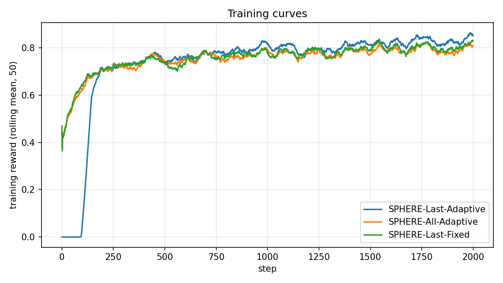
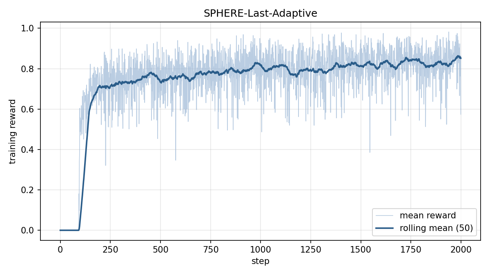
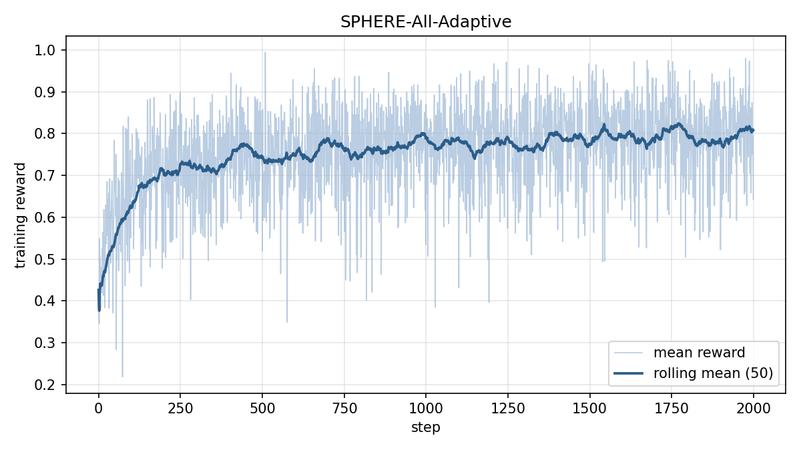
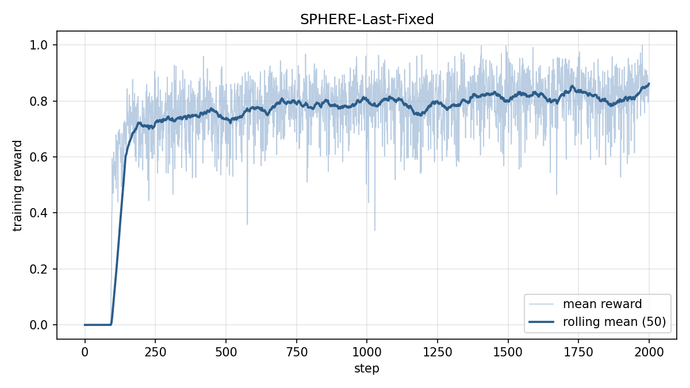
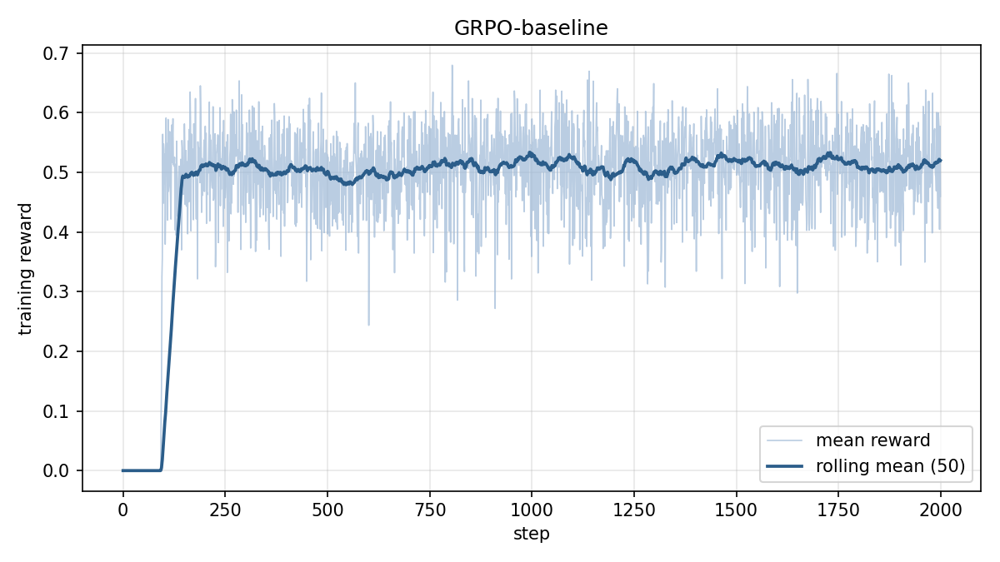
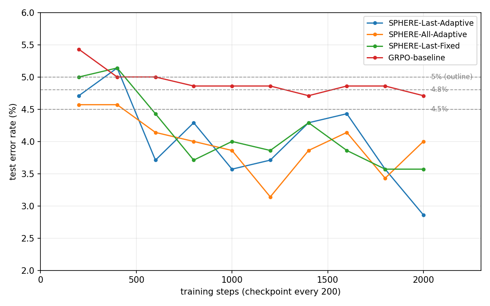

# SNIPS/logs —— 训练曲线与评测汇总

每个模型一个子目录，含 `curves.png` 训练曲线图与 `curves.csv` 逐 step
数据，生成脚本为 `scripts/plot_songce_curves.py`。`curves-all.png` 为
全部已训模型的对比总图。`error-rate-curves.png` 为 test 错误率-训练
步数曲线，是高效性判据的可视化。`evaluate.py` 的汇总输出写在本目录
`evaluate-summary.txt`。

| 子目录 | 内容 | 说明 |
|---|---|---|
| `SPHERE-Last-Adaptive/` | `curves.png` + `curves.csv` + `training-log.jsonl` | 项目算法 1 |
| `SPHERE-All-Adaptive/` | `curves.png` + `curves.csv` + `training-log.jsonl` | 项目算法 2 |
| `SPHERE-Last-Fixed/` | `curves.png` + `curves.csv` + `training-log.jsonl` | 项目算法 3 |
| `GRPO-baseline/` | `curves.png` + `curves.csv` + `training-log.jsonl` | 基线模型 |

RandomInit 为训练前模型，无训练曲线，不建子目录，零样本错误率 100%。

各模型训练曲线：

## 高效性判据

大纲 4.2.2.4(3) 第 4 步要求"错误率达到 5% 所需训练迭代次数"的对比。
各模型训练时每 200 步保存检查点，逐检查点加载权重后跑一次 test 集评测，
由 `scripts/nm_sweep.sh` 汇总为 `nm-sweep.csv` 并绘制
`error-rate-curves.png`，得到错误率-步数曲线。
错误率首次不超过各阈值的训练步数：

| 错误率阈值 | SPHERE-Last-Adaptive | SPHERE-All-Adaptive | SPHERE-Last-Fixed | GRPO 基线 |
|---|---|---|---|---|
| 5% | 200 | 200 | 200 | 400 |
| 4.8% | 200 | 200 | 600 | 1400 |
| 4.5% | 600 | 600 | 600 | 未达到 |
| 4% | 600 | 800 | 800 | 未达到 |

大纲判据线 5% 上三种 SPHERE 算法均在首个检查点 200 步达到，GRPO
基线到 400 步才达到，项目算法所需训练步数少于基线。更严的 4.8% 线上
三算法分别为 200、200、600 步，基线需要 1400 步。4.5% 与 4% 线三
算法全部达到，基线在整个 2000 步训练中均未达到，最低错误率 4.71%。

## curves.csv 字段

- `step`：训练步，从 0 起
- `mean_reward`：该步 4 prompt × 16 rollout 的平均训练奖励，即
  0.5×intent_ok + 0.5×shaped-slot
- `roll50`：最近 50 步 mean_reward 的滚动均值，用于平滑
